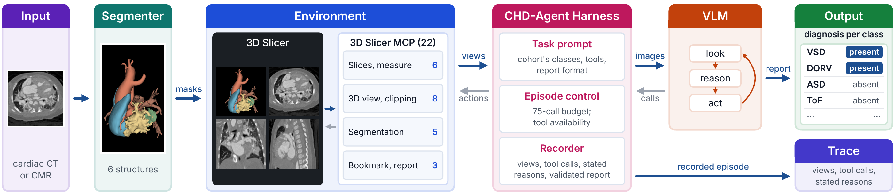
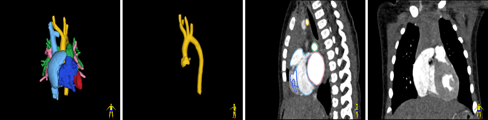

# CHD-Bench

A benchmark for vision-language models (VLMs) as agents that diagnose congenital heart disease (CHD) from 3D cardiac
CT and MRI. This repository holds CHD-Bench (cohorts, class lists, scoring) and CHD-Harness, the episode runner: the
VLM controls a live [3D Slicer](https://www.slicer.org) session through 22 MCP tools (slices, 3D view, clipping,
measurements, segmentation display) and submits one present/absent call per class.



Views from one run on an ImageCHD CT (the heart structures as 3D shells, the aorta isolated, sagittal and coronal
slices):



The viewer is [slicer-eval-mcp](https://github.com/Maitri-Labs-Amrita/slicer-eval-mcp), a general MCP server for
3D Slicer (Python package `slicer-mcp`). CHD-Bench adds the tasks, prompts, model connections, datasets and scoring.

**Every default is the paper's setting.** A run with only a scan, a segmentation and a model uses the settings of
the paper. [Section 5](#5-the-papers-settings) lists them.

**Contents:**
[1 Install](#1-install) ·
[2 Data](#2-data) ·
[3 First run](#3-first-run) ·
[4 Segmentation masks](#4-segmentation-masks) ·
[5 The paper's settings](#5-the-papers-settings) ·
[6 Reproduce the paper's tables](#6-reproduce-the-papers-tables) ·
[7 Scoring](#7-scoring) ·
[8 Your own scan](#8-your-own-scan) ·
[9 A model on your own GPU](#9-a-model-on-your-own-gpu) ·
[10 Reference](#10-reference)

## 1. Install

| You need | |
|---|---|
| Linux or macOS | Windows is not supported. The viewer renders on CPU. A local model needs a GPU. |
| git, [uv](https://docs.astral.sh/uv/) | uv installs Python and all dependencies; it uses git to fetch slicer-mcp. |
| 3D Slicer 5.10.0 | Linux: setup reuses a `Slicer-5.10.0-linux-amd64` folder under your home folder or `/opt` (or `--slicer PATH`), else downloads it (414 MB) into `~/Applications/`. macOS: install the x86_64 build of [Slicer 5.10.0](https://download.slicer.org/) into `/Applications` first. |

```bash
git clone https://github.com/Maitri-Labs-Amrita/CHD-Bench.git
cd CHD-Bench
./setup.sh
```

On Linux, setup installs Xvfb and the system libraries Slicer needs into `~/.local/slicer-mcp-headless/`, without
sudo (Ubuntu and Debian; on other Linux, install Xvfb first).

## 2. Data

The two public cohorts of the paper run with this repository. 3DLabsCHD (86 CT scans) is private.

| Dataset | Scans in the benchmark | Download | Folder contents | Set it |
|---|---|---|---|---|
| ImageCHD (Xu et al., MICCAI 2020) | 110 CT (all) | [Kaggle](https://www.kaggle.com/xiaoweixumedicalai/datasets) (free account) | `ct_<id>_image.nii.gz`, `ct_<id>_label.nii.gz`, `imagechd_dataset_image_info.xlsx`, `imageCHD_dataset_diagnosis_info(updated20210510).xlsx`, all in one folder | `./setup.sh --imagechd-dir <folder>` |
| HVSMR-2.0 (Pace et al., Scientific Data 2024) | 51 of 60 MRI | [figshare](https://doi.org/10.6084/m9.figshare.c.7074755.v2) ([home page](https://segchd.csail.mit.edu/)) | `orig/pat<N>_orig.nii.gz`, `orig/pat<N>_orig_seg.nii.gz`, `hvsmr_clinical.csv` | `./setup.sh --hvsmr-dir <folder>` |

`./run.sh --list imagechd` and `./run.sh --list hvsmr` list the cases with their diagnoses. Labels, exclusions and
class lists: [section 7](#7-scoring).

## 3. First run

1. Test the installation. No model is called: a fixed script makes a few tool calls and submits "no defect", which
   checks that Slicer, the tools and the scoring work.

   ```bash
   ./run.sh --imagechd 1001 --segmentation gt --dry-run-scripted
   ```

2. Put your API key in `.env` (gitignored):

   ```bash
   echo 'OPENROUTER_API_KEY=sk-or-...' >> .env
   ```

   | `--model` | Key in `.env` |
   |---|---|
   | `claude-opus-5-5` or another Anthropic model id | `ANTHROPIC_API_KEY` |
   | `openrouter:<vendor>/<model>` | `OPENROUTER_API_KEY` |
   | `local:<name>` ([section 9](#9-a-model-on-your-own-gpu)) | none |

3. Run one case with the paper's settings:

   ```bash
   ./run.sh --imagechd 1001 --segmentation gt --model openrouter:google/gemini-4-argon   # ImageCHD case 1001 (CT)
   ./run.sh --hvsmr 3 --segmentation gt --model openrouter:google/gemini-4-argon        # HVSMR-2.0 case 3 (MRI)
   ```

   A paid run asks for confirmation first (`--yes` skips it). Outputs: [section 10](#outputs).

`--segmentation gt` shows the model the dataset's ground-truth segmentation. The paper showed predicted segmentations instead.
See [section 4](#4-segmentation-masks).

## 4. Segmentation masks

In the paper, the model sees six heart structures (LV, RV, LA, RA, Ao, PA) as 3D shells and as outlines on the
slices. These masks came from a segmentation model, and each scan's mask was predicted out-of-fold (by a model
that did not train on that scan).

| `--segmentation` | What the model sees |
|---|---|
| `gt` | the dataset's ground-truth segmentation (ImageCHD and HVSMR-2.0 only) |
| a file path | your mask for this scan |
| not given | no segmentation and no segmentation tools (the paper's "No segmentation" setting) |

### Mask file format

- One NIfTI label map on the scan's grid: the same size and affine as the image file of the dataset.
- Label values 1 LV, 2 RV, 3 LA, 4 RA, 6 Ao, 7 PA, in both cohorts. Other values are not shown (5, the myocardium,
  is not shown). For other values, give `--segmentation-map`, e.g. `--segmentation-map 1=LV,2=RV,3=LA,4=RA,5=Ao,6=PA`
  (the HVSMR-2.0 values).

## 5. The paper's settings

### The episode

| Setting | Value | Option |
|---|---|---|
| Tool-call budget | 75 calls | `--max-steps` |
| Cost cap per episode | USD 10 | `--cost-cap` |
| Output cap per model turn | 32,000 tokens | `--max-tokens` |
| Reasoning effort | per model, table below | `--effort` |
| Sampling temperature | not sent: each provider's default | none |
| Images | 512 × 512 per view, lossless (PNG to Anthropic, lossless WebP to OpenRouter) | none |
| Conversation | the full history with every earlier image in each request | `--max-images`, `--image-window` (off) |
| Tool calls in one turn | run in order, one after the other | none |
| Start state | the 3D view shows the segmented heart from the front, without the chest | none |
| System prompt | picked from the scan and the setting (table below); files in `prompts/`, sha256 in `prompts/registry.json` | `--prompt` |
| Random seed | 0, recorded in the run metadata; not sent to the model API | `--seed` |

System prompts (`prompts/`):

| Setting | ImageCHD (CT) | HVSMR-2.0 (MRI) |
|---|---|---|
| Full configuration (`--segmentation`) | `chd_ct_v1` | `chd_mr_v1` |
| No 3D (`--segmentation --no-3d`) | `chd_ct_2dseg_v1` | `chd_mr_2dseg_v1` |
| No segmentation (no `--segmentation`) | `chd_ct_nomask_v1` | `chd_mr_nomask_v1` |

The MRI prompts differ from the CT prompts in three places: they name MRI instead of CT, they list the 20 HVSMR-2.0
classes plus normal, and they add a note that MRI intensities are signal values, not HU. The no-segmentation prompts
are the full prompts without the sentence on the loaded segmentation and without the segmentation tools.

### The models

The paper sets each model to its highest reasoning setting. `--effort` replaces it. A model that is not in this table
gets `max`; if its provider refuses `max`, pass a lower `--effort`.

| Model | `--model` | Effort | Mean cost per case in the paper |
|---|---|---|---|
| Gemini 4 Argon | `openrouter:google/gemini-4-argon` | high | $1.31 |
| GPT-6.1 Sol | `openrouter:openai/gpt-6.1-sol` | max | $0.74 |
| Claude Opus 5.5 | `claude-opus-5-5` | max | $2.91 |
| Kimi K3.1 Pro | `openrouter:moonshotai/kimi-k3.1-pro` | max | $1.16 |
| Muse Spark Open | `openrouter:meta/muse-spark-open` | max | $0.49 |
| DeepSeek V4.1 Flash | `openrouter:deepseek/deepseek-v4.1-flash` | max | $0.21 |
| Qwen3.8-27B | `openrouter:qwen/qwen3.8-27b` | max | $0.26 |

Provider routing (`config/providers.json`): Claude Opus 5.5 goes to the Anthropic API. The other models go through
OpenRouter with data collection denied. Gemini and the open-weight models also request zero-data-retention
endpoints. GPT-6.1 Sol runs on OpenAI only.

Retries in the paper:

- **DeepSeek and Qwen:** two cases each stopped at the output cap. They were run again with `--max-tokens 64000`.
- **Moderation blocks:** OpenRouter's moderation blocked one ImageCHD scan and one 3DLabsCHD scan for GPT-6.1 Sol.
  They were run again through Amazon Bedrock, which takes at most 100 images per request:
  `--model openrouter_bedrock:openai/gpt-6.1-sol --max-images 96`. Older images become text placeholders, and their
  JSON is kept.

## 6. Reproduce the paper's tables

Each row of the paper that this repository can run has a batch config in `slurm/paper/`. The configs hold the
paper's cases, models and settings, and `labels: "gt"` (the ground-truth segmentations). For your own predicted masks, set
`labels` to a path with `{case}` (the case id: `1001`, `3`) or `{stem}` (`ct_1001`, `hvsmr_3`).

| Paper row | Cohort | Config | Runs | Paper cost |
|---|---|---|---|---|
| Table 1, seven interactive VLMs | ImageCHD | `slurm/paper/main_imagechd.json` | 7 × 110 | about $780 |
| Table 1, seven interactive VLMs | HVSMR-2.0 | `slurm/paper/main_hvsmr.json` | 7 × 51 | about $360 |
| Table 2, No 3D (Gemini) | ImageCHD | `slurm/paper/no3d_imagechd.json` | 110 | about $125 |
| Table 2, No 3D (Gemini) | HVSMR-2.0 | `slurm/paper/no3d_hvsmr.json` | 51 | about $58 |
| Table 2, No segmentation (Gemini) | ImageCHD | `slurm/paper/noseg_imagechd.json` | 110 | about $150 |
| Table 2, No segmentation (Gemini) | HVSMR-2.0 | `slurm/paper/noseg_hvsmr.json` | 51 | about $69 |

Paper cost: the paper's mean cost per case times the number of runs.

1. Print the plan of one job:

   ```bash
   uv run python slurm/run_batch.py --config slurm/paper/main_imagechd.json --job 0 --plan
   ```

2. Check the batch without API calls (scripted model):

   ```bash
   slurm/submit_parallel.sh slurm/paper/main_imagechd.json --dry-run-scripted
   ```

3. Run the batch. With SLURM, each job (one model) is one array task:

   ```bash
   slurm/submit_parallel.sh slurm/paper/main_imagechd.json
   ```

   Without SLURM, run the jobs one after the other on one Linux machine:
   `uv run python slurm/run_batch.py --config slurm/paper/main_imagechd.json --job <k>` for k = 0 to 6.
   A job runs its cases one after the other. To run faster, split a job's `cases` over several jobs with the same
   `model` and `effort`: the scorer pools jobs of the same model.

4. Score the batch (macro F1, precision, recall per model, with 95% bootstrap intervals):

   ```bash
   uv run --group analysis python slurm/batch_metrics.py slurm/batches/paper-main_imagechd
   ```

The paper's other rows are not in this repository: the static-view setting, the medical VLM baselines
(ClinFusion-8B, M3D-LaMed, NV-Reason-CT, MedGemma-27B) and the MedicalNet classifier.

Batch options, requeue and resume, and the audit command: [slurm/README.md](slurm/README.md).

## 7. Scoring

### Metrics

- Precision, recall and F1 for each class, then the mean over classes (macro) within each cohort. Each cohort is
  scored on its own class list.
- A class enters the mean only when it has at least one true case. Normal enters the mean in ImageCHD (13 Normal
  cases) and HVSMR-2.0 (8 Normal cases).
- A case is Normal when the model calls no defect present.
- A class with true cases and no predicted cases has precision 0.
- A planned case without an accepted report counts as every class absent.
- 95% intervals: 2,000 patient-level bootstrap resamples within the cohort (seed 0). Each resample leaves out
  classes with no true cases. The interval is the point estimate ± 1.96 × the bootstrap standard error.

One run: `uv run --no-sync rescore <run folder>` scores it again. A batch: `slurm/batch_metrics.py` (section 6). The
scoring rules are in `config/scoring_v1.json` and `src/chd_client/task/eval_diagnosis.py`.

### ImageCHD (110 CT scans, 15 scored classes plus Normal)

- Labels: the diagnosis sheet updated on 10 May 2021 (`imageCHD_dataset_diagnosis_info(updated20210510).xlsx`).
  The older sheet is not read.
- Normal: 6 scans are labelled Normal. 7 scans have no diagnosis in either sheet and are scored as Normal. In
  total, 13 scans are Normal.
- AVSD is not scored. In the updated sheet, the AVSD column is the logical AND of the ASD and VSD columns, so it
  marks every case with both an ASD and a VSD as AVSD. The model still reports AVSD, and an AVSD call still rules out
  Normal.

### HVSMR-2.0 (51 of 60 MRI scans, 20 classes plus Normal)

- Labels: `hvsmr_clinical.csv`. The paper uses 20 of its labels as CHD classes. It leaves out prior surgery (e.g.
  Glenn, Fontan), Marfan syndrome, imaging artifacts and chamber dilation, because they do not name a CHD type.
- 9 scans have no label left after this: 8 have dilation as their only finding and 1 has no clinical record. They
  are not evaluated. 8 of the 51 are Normal.

### Class codes

From [config/chd_classes.csv](config/chd_classes.csv). ImageCHD's 16 classes:

| Code | Class | Code | Class |
|---|---|---|---|
| ASD | Atrial septal defect | DAA | Double aortic arch |
| VSD | Ventricular septal defect | IAA | Interrupted aortic arch |
| AVSD | Atrioventricular septal defect | PuA | Pulmonary atresia |
| ToF | Tetralogy of Fallot | APVC | Anomalous pulmonary venous connection |
| TGA | Transposition of the great arteries | DSVC | Double superior vena cava |
| DORV | Double outlet right ventricle | PDA | Patent ductus arteriosus |
| CAT | Common arterial trunk | PAS | Pulmonary artery sling |
| CoA | Coarctation of the aorta | AAH | Aortic arch hypoplasia |

HVSMR-2.0's 20 classes: `./run.sh --list classes`. The paper writes PA for pulmonary atresia and CA for common
atrium; on the command line, `PA` is the pulmonary artery segment and pulmonary atresia is `PuA`.

## 8. Your own scan

```bash
./run.sh --volume /path/to/patient_folder --model openrouter:google/gemini-4-argon
```

| You have | Give |
|---|---|
| a DICOM folder | `--volume <folder>`. Searched at any depth; other files are ignored; with several series, the one with the most files is used |
| a NIfTI, NRRD or MHA file | `--volume <file>` |
| an MRI | `--modality mr` (a DICOM scan's modality is read from its header) |
| a heart segmentation of the scan | `--segmentation <file>` ([format](#mask-file-format)) |
| the known diagnosis | `--truth VSD ToF`, or `--truth normal` ([class codes](#class-codes)). Without `--truth` the run is not scored |

With a DICOM folder as `--volume`, the segmentation must be on the grid of the converted scan. If you made it on a
NIfTI copy of the scan, give that NIfTI as `--volume`.

Use de-identified scans only: CHD-Bench drops the DICOM patient fields, not text burned into the images.

## 9. A model on your own GPU

`local:` models run through `chd-gateway`, an OpenAI-compatible server (Transformers, vLLM, or an existing server
such as Ollama). Terminal 1:

```bash
uv sync --frozen --inexact --extra transformers
uv run chd-gateway serve --profile config/gateway/qwen2.5-vl-3b.transformers.local.yaml --port 8098 \
  --workdir data/gateway
```

Terminal 2 (the model name is `local:` plus the profile's `name`):

```bash
echo 'CHD_LOCAL_BASE_URL=http://127.0.0.1:8098/v1' >> .env
./run.sh --imagechd 1001 --segmentation gt --model local:qwen2.5-vl-3b
```

Other models, vLLM, SLURM GPU jobs and remote servers: [docs/GATEWAY.md](docs/GATEWAY.md).

## 10. Reference

### What the model gets

| Options | The model gets | Paper setting |
|---|---|---|
| `--segmentation` | the scan, the segmentation as 3D shells and slice outlines, the 3D view, all 22 tools | full configuration (Table 1) |
| `--segmentation --no-3d` | the scan and the segmentation outlines in the slices; no 3D view; 12 tools | No 3D |
| no `--segmentation` | the scan and the 3D view; no segmentation; 17 tools | No segmentation |

The tools as the model receives them: [docs/TOOLS.md](docs/TOOLS.md).

### Outputs

Each run writes a folder in `reports/runs/`:

- `report.pdf`: every step with its images
- `metrics.json`: the scores
- `trace/`: the tool calls, the states, the images, the report
- the full model transcript
- `provenance/`: commits, prompt and tool hashes, input hashes
- `slicer/open_me.mrml`: opens the case in Slicer as the model left it

### Every option

`./run.sh --help` and `./setup.sh --help`. Details, stop reasons and exit codes: [docs/RUNNING.md](docs/RUNNING.md).
Models and providers: [docs/MODELS.md](docs/MODELS.md).

### Tests

```bash
uv run --no-sync pytest -q
```

### License

Apache-2.0 ([LICENSE](LICENSE)).
